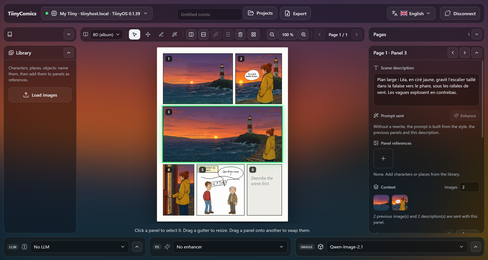

# TiinyComics

Create comic pages (Franco-Belgian BD, US comics, manga and webtoon) with Qwen-Image 2.1 on the Tiiny AI Pocket Lab. Each panel is generated from its description, its reference images and the panels before it. It is a static web page with no backend or build step: the browser talks directly to the Tiiny API. It shares its interface and its API client with [TiinyPaint](https://github.com/mcornier/TiinyPaint).

## Run

Open `web/index.html` in Chrome or Edge (double-click), then enter the Tiiny address (`http://tiinyhost.local` by default on the local network, otherwise `http://` followed by its IP over USB or Wi-Fi) and the API key (TiinyOS → Settings → API Key). The key stays in the browser's `localStorage` and is never written to the repo.

The Tiiny must be unlocked: after a restart, the API returns 502 until TiinyOS has been opened.

Load Qwen-Image 2.1 from the **Image** block of the chain at the bottom. The prompt enhancer (**PE**) and the **LLM** are optional.

## Features

- **Formats**: BD album (24 × 32 cm), US comics, manga (read right to left, panel 1 on the right) and webtoon (vertical strips of free height). Pages can be added, removed and reordered.
- **Panel layout**: split a panel into columns or rows, eleven templates, drag a gutter to resize, drag a panel onto another to swap them, merge neighbouring panels, separate a shared gutter (double-click it), add a row under a webtoon strip. Render sizes follow the panel shape.
- **Generation with context**: a panel is rendered from its description, its references from the library (named characters, places, objects) and the images and descriptions of the previous panels, across pages. An LLM or the PE can rewrite the prompt first, and the rewrite stays editable.
- **Quality presets**: draft (512 px), then 1, 2 or 4 MP at the panel's shape. **Upscale** an existing image to 1, 2 or 4 MP (sizes it already reaches are greyed out).
- **Framing**: move and zoom the image inside its panel; **Extend** paints the uncovered area and keeps the original pixels.
- **Sketch**: in Sketch mode, draw freely or place rough characters, speech bubbles, thought bubbles, narrative boxes and sound effects, then type their text. The render follows the sketch's layout and letters the bubbles with that text. Undo and redo with Ctrl+Z and Ctrl+Y.
- **Retouch**: TiinyPaint's editor on the panel image (mask brush, eraser, lasso, rectangle, restore, clone stamp, crop, rotate, flip) with localized diffusion through the mask. **Text fix**: mask a badly lettered bubble, type the right text, and only that area is regenerated.
- **Progress**: the panel shows a loading animation, and the Image block shows the percentage, the step and the time left, with previews at 50, 75 and 90 %.
- **Nothing is lost**: every render, upscale, extension, retouch and sketch is kept as a version of its panel, in the browser (IndexedDB). A whole project can be saved to and loaded from a `.tiinycomic` file.
- **Export**: the page as PNG, all pages as a ZIP, a PDF at the format's print size (right to left for manga), or the whole webtoon as one long image.
- **Interface**: fixed side columns that collapse, page zoom (buttons, Ctrl + wheel, double-click on a panel), stylus support, 5 languages (English, French, Spanish, German, Italian).

## What we learned on the Tiiny

- With input images, Qwen-Image 2.1 behaves as an editing model. Sent as images, previous panels can be copied into the new one, so the prompt states that they are references only. With a sketch, the sketch goes first with a short "transform this sketch" instruction, and previous panels are sent as text only.
- A magenta frame around the image does not work for extending it: the model enlarges the picture instead. A blurred mirror of the image's edges keeps the composition aligned.
- The stream only reports the steps it is asked to preview, and each preview costs about 2.5 s at 1 MP. Steps 1 and 2 are always requested, not shown, to time the encoding and one step; the progress is extrapolated from them.

## Structure

| File | Purpose |
|---|---|
| `web/app.js` | Interface, project, generation and retouch workflows |
| `web/project.js` | Data model: formats, page layout tree, sizes and presets (also runs in Node) |
| `web/pageview.js` | Interactive page view: selection, gutters, framing, sketch editing, zoom |
| `web/generate.js` | Context, prompts and requests for panel renders, upscale, extend and retouch |
| `web/sketch.js` | Sketch elements, SVG drawing and export for the model |
| `web/store.js` | Projects and images in IndexedDB, `.tiinycomic` files |
| `web/export.js` | PNG, ZIP and PDF export |
| `web/api.js` | Tiiny API client (models, image stream, chat stream), from TiinyPaint |
| `web/editor.js` | Canvas editor and localized diffusion, from TiinyPaint |
| `web/i18n.js`, `web/i18n-comics.js` | Translations |
| `web/prompts.js` | Official PE-I2I and PE-T2I system prompts |
| `docs/ARCHITECTURE.md` | Data model, persistence and generation details |
| `tests/` | Node tests: `node tests/project.test.js`, `node tests/generate.test.js`, `node tests/export.test.js` |

## License

The code is under Apache 2.0, except `web/prompts.js`, which contains Qwen's system prompts under the Qwen research license: **non-commercial use only**. Icons come from Lucide, under the ISC license. See [NOTICE](NOTICE). The Qwen-Image 2.1, PE-I2I and PE-T2I models are not included here and are under the same license: commercial use requires a separate agreement with Qwen.
